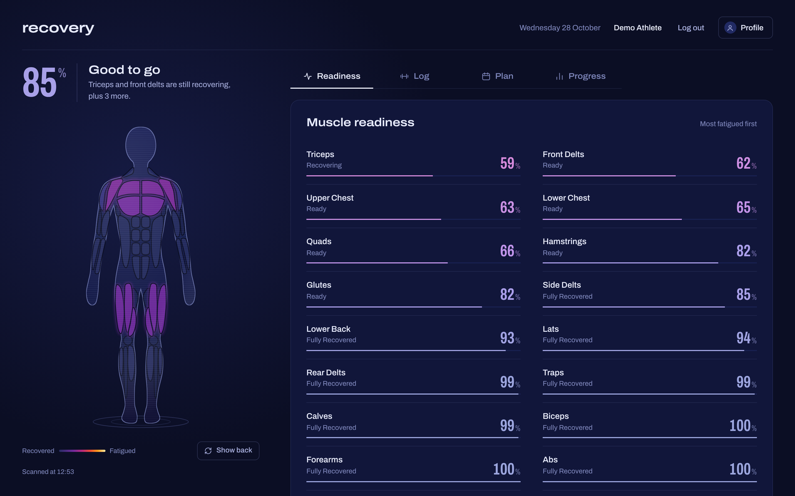
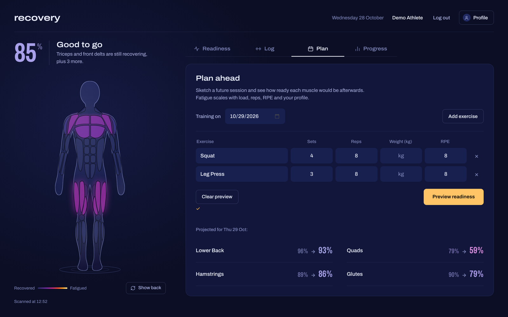
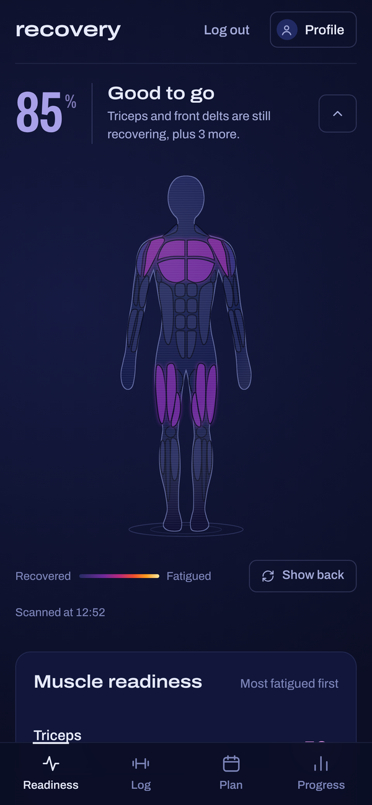

# Recovery Interface

[](https://github.com/raff-bit/Recovery-interface/actions/workflows/ci.yml)


**A training-recovery tracker that shows, muscle by muscle, how ready your body is for the next session.**
Log a workout, and an exponential-decay fatigue model updates a live body map of 17 muscle groups.
Plan a future session, and it projects what your readiness would be afterwards.



<table>
  <tr>
    <td width="70%"></td>
    <td width="30%"></td>
  </tr>
</table>

---

## What it does

- **Readiness map** — 17 muscle groups, colour-coded from recovered to fatigued, on a front/back body map.
- **Workout log** — 52 exercises, each mapped to the muscles it trains (primary/secondary activation). Edit and delete past sessions.
- **Planner** — sketch a future session and see each muscle's readiness *before → after* on that date, without saving anything.
- **Progress** — weekly volume over 8 weeks, set distribution per muscle group, most-trained exercises.
- **Personalisation** — optional profile (body weight, age, sex, activity level) scales fatigue by *relative* load and adjusts recovery speed. No profile → the unpersonalised baseline, unchanged.
- **Data export** — your full history as JSON or CSV.

## How the model works

Each logged set adds fatigue to every muscle it trains, which then decays exponentially:

```
fatigue_set = 12 × (RPE / 10) × activation × relative_load
remaining   = fatigue_set × e^(−3 · t / T_recovery)
readiness   = clamp(0, 100, 100 − Σ remaining)
```

`T_recovery` is each muscle's base recovery window (24–72 h) adjusted by the profile. With `k = 3`, about 95 % of a set's fatigue is gone after one full window.
Full specification, coefficients and limitations: **[docs/recovery-model.md](docs/recovery-model.md)**.

> It's a heuristic for planning training, not a medical or physiological measurement.

---

## Engineering highlights

**Architecture.** Four layers with one-way dependencies, no framework:

```
js/      ES modules (UI, state, single API transport)  ──HTTP/JSON──▶
pages/   thin endpoints: auth, validation, response shaping
bll/     business rules: RecoveryCalculator, WorkoutValidator, AuthThrottle, PasswordPolicy
dal/     repositories (PDO, prepared statements only)
MySQL / MariaDB (InnoDB)
```

**Security.**
- Every endpoint goes through one bootstrap: hardened session cookie (`HttpOnly`, `SameSite=Lax`, strict mode), **CSRF** tokens on every state-changing request, and a global error handler, so no stack trace ever reaches the browser.
- **Content-Security-Policy** with `script-src 'self'`; all user-entered text rendered via `textContent`.
- **Brute-force throttling**: 5 failed logins per account and 20 per IP per 15 min, plus a timing-safe login so response times don't reveal which emails exist. Registration is rate-limited too.
- Passwords: bcrypt, 10–72 bytes (bcrypt's real limit), common-password deny-list.
- Input validation follows *reject, don't repair*: `"12abc"` reps is a 400, never silently `12`.
- `.htaccess` blocks `.git/`, `.env`, `config/`, `tests/`, dumps…; the smoke test verifies it on every push.
- No third-party requests: the font is self-hosted, with no analytics and no CDNs.

**Database.**
- Versioned migrations (`database/migrations/`) applied once, in order, tracked in `schema_migrations`.
- Composite index `(user_id, workout_date)` matching the hot queries. Measured on 480 k sets: DB time per page load **9.3 ms → 4.2 ms**; the readiness query reads 13 rows instead of 400 per user.
- `CHECK` constraints mirror the validator at the database level (defence in depth).
- Everything is stored in **UTC**; the browser converts to local time. Strict SQL mode, pinned per connection.
- Consistent backups via `mysqldump --single-transaction`, never copied data folders.

**Testing & CI.** On every push, GitHub Actions runs:
- `composer validate`, `composer audit` (known vulnerabilities), `php -l` on every file
- **PHPStan level 6** static analysis
- **PHPUnit** on PHP 8.1 and 8.3, with 41 unit tests using stubs instead of a database. The tests pin the model's exact numbers, not just its direction.
- an **end-to-end smoke test**: a real Apache + MariaDB, a fresh install, then 50 HTTP checks covering file exposure (including backups), CSP, CSRF, throttling, payload limits, the full workout lifecycle and UTC handling.

## Tech stack

PHP 8.1+ (no framework) · MySQL 8.0.16+ / MariaDB 10.4+ · vanilla JavaScript (ES modules) · CSS · Apache
Dev tooling: Composer, PHPUnit, PHPStan, GitHub Actions

---

## Getting started (XAMPP)

**Requirements:** PHP 8.1+ with `pdo_mysql` and `mbstring`, MySQL 8.0.16+ or MariaDB 10.4+, Apache with `mod_rewrite` and `mod_headers` (XAMPP has all of these).

1. **Clone into `htdocs/`**
   ```bash
   cd /c/xampp/htdocs
   git clone https://github.com/raff-bit/Recovery-interface.git recovery
   cd recovery
   ```
2. **Configure**: copy `.env.example` to `.env` and set your database credentials.
3. **Create an empty database** (e.g. `muscle_recovery_v2` in phpMyAdmin), then install schema, seeds and migrations in one go:
   ```bash
   php database/install.php
   ```
4. **Optional demo data**: an account with 3 weeks of push/pull/legs training. The password is random and printed once.
   ```bash
   php database/seed_demo.php
   ```
5. Open **http://localhost/recovery/**

**Upgrading an existing install:** `php database/migrate.php` (`--status` lists what's applied).
**Backups:** `php database/backup.php` writes a compressed, consistent dump to `backups/` (or `BACKUP_DIR` from `.env`) and keeps the latest 14.

### Before exposing it to a network

The defaults are meant for a personal machine. If others can reach your instance:

- **Serve it over HTTPS.** The session cookie automatically becomes `Secure`.
- **Keep `APP_ENV=production` and `APP_DEBUG=false`**, which are the defaults in `.env.example`.
- **Use a dedicated database user** with a strong password, not XAMPP's password-less `root`.
- **Set `BACKUP_DIR` outside the web root.** Dumps contain every account's data.
- **On nginx or another server that ignores `.htaccess`**, replicate its rules. Only `index.html`, `css/`, `js/` and `pages/` should be public.
- **Behind a reverse proxy**, sign-in throttling sees the proxy's IP. Configure trusted forwarding first.
- **Personal use only?** Bind Apache to `127.0.0.1` so other devices on your Wi-Fi can't reach it.

## Running the checks

```bash
composer install
composer test          # PHPUnit: unit tests, no database needed
composer analyse       # PHPStan level 6
composer test:smoke    # end-to-end HTTP checks against your running app
                       # (BASE_URL=http://localhost/recovery composer test:smoke)
```

## Project structure

```
bll/                 business logic (model, validation, auth rules)
dal/                 repositories: all SQL lives here
pages/               JSON API endpoints
config/              bootstrap (security), env loader, DB connection
js/  css/            frontend (ES modules, modular CSS, self-hosted font)
database/            schema, seeds, migrations, install/migrate/backup/demo scripts
tests/Unit/          PHPUnit suites
tests/ApiSmokeTest.php   end-to-end HTTP checks
docs/                model specification, screenshots
```

## Roadmap

- Self-service account deletion and an export button in the UI (both are API-only today)
- Learning per-user recovery constants from post-session soreness feedback
- Remove `'unsafe-inline'` from the style CSP (move the remaining inline styles to classes)
- Offline-capable PWA

## Privacy

The app stores body metrics and training history. What is stored, why, and how to get it out is described in **[PRIVACY.md](PRIVACY.md)**.

## License

Copyright © 2026 Rafael Monteiro.
Licensed under the **[GNU Affero General Public License v3.0](LICENSE)**. You may use, study, modify and share it. If you run a modified version as a network service, you must make your source code available to its users under the same license.
The Archivo font in `css/fonts/` is © The Archivo Project Authors, under the [SIL Open Font License 1.1](css/fonts/OFL.txt).
